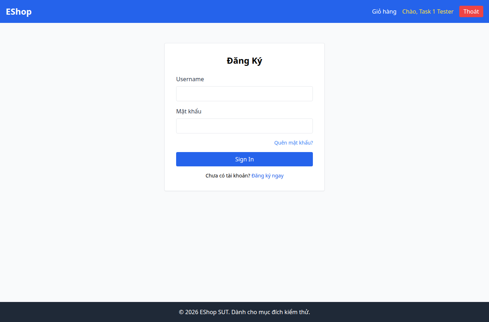

# BUG-001 — Trang đăng nhập mang tiêu đề Đăng Ký

- Mức độ: **Minor**
- Loại: Vi phạm đặc tả
- Checklist: GUI-001
- Môi trường: Linux x86_64; Chrome headless 156.0.8078.79; 1366×900, trừ ca responsive 360×800.
- SUT: eshop-sut commit 85af3ba; code không sửa trong lượt test.
- GitHub Issue: Chưa đăng — chờ repository đích của sinh viên.

## Các bước tái hiện

Mở /login. Quan sát tiêu đề form.

## Kết quả mong đợi và thực tế

### GUI-001
- Cơ sở: FR-21
- Mong đợi: Tiêu đề trang mô tả đúng chức năng Đăng nhập
- Thực tế: Tiêu đề thực tế: Đăng Ký
- URL: http://localhost:5173/login
- Thời gian UTC: 2026-11-10T04:05:41.163Z

## Giới hạn bằng chứng

Ảnh chụp trực tiếp bằng Playwright. Kiểm tra DOM, computed style và nội dung native alert nằm trong `../task1/evidence/results.json`. Native alert được Playwright ghi nhận rồi đóng; ảnh sau đó chụp nền trang, không phải ảnh của hộp thoại. Không dựng lại hộp thoại để làm bằng chứng.
