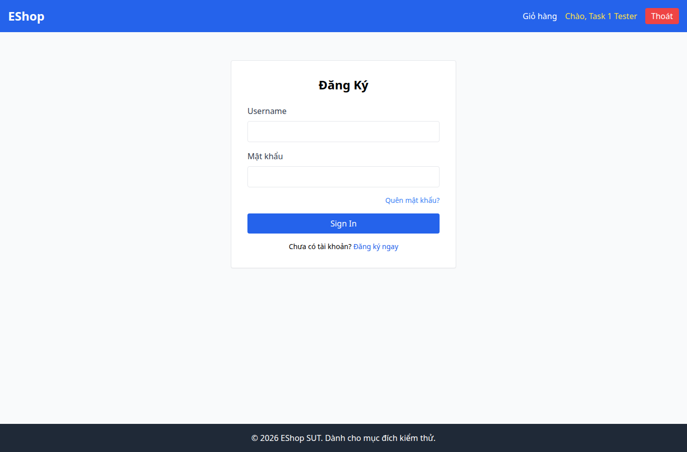
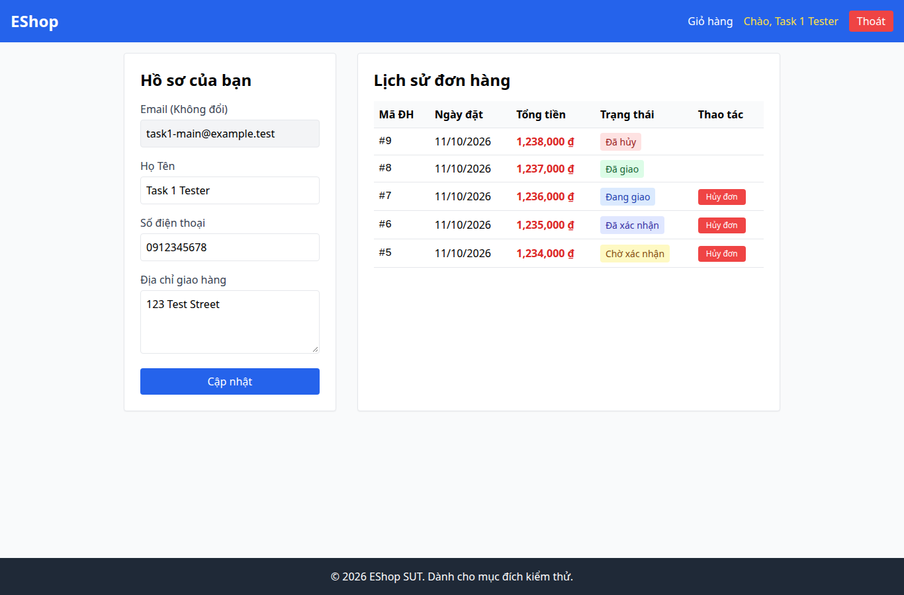

# BUG-002 — Login và Profile thiếu h1 mô tả trang

- Mức độ: **Minor**
- Loại: Vi phạm đặc tả
- Checklist: GUI-002, GUI-023
- Môi trường: Linux x86_64; Chrome headless 156.0.8078.79; 1366×900, trừ ca responsive 360×800.
- SUT: eshop-sut commit 85af3ba; code không sửa trong lượt test.
- GitHub Issue: https://github.com/vinh-code/HW03-Software-Testing/issues/2

## Các bước tái hiện

Mở /login rồi /profile sau đăng nhập. Inspect DOM trong main: kiểm tra số h1.

## Kết quả mong đợi và thực tế

### GUI-002
- Cơ sở: FR-21
- Mong đợi: Có đúng một h1 mô tả trang
- Thực tế: Số h1: 0
- URL: http://localhost:5173/login
- Thời gian UTC: 2026-11-10T04:05:41.206Z

### GUI-023
- Cơ sở: FR-21
- Mong đợi: Có đúng một h1 mô tả trang
- Thực tế: Số h1: 0
- URL: http://localhost:5173/profile
- Thời gian UTC: 2026-11-10T04:06:34.366Z

## Giới hạn bằng chứng

Ảnh chụp trực tiếp bằng Playwright. Kiểm tra DOM, computed style và nội dung native alert nằm trong `../task1/evidence/results.json`. Native alert được Playwright ghi nhận rồi đóng; ảnh sau đó chụp nền trang, không phải ảnh của hộp thoại. Không dựng lại hộp thoại để làm bằng chứng.
