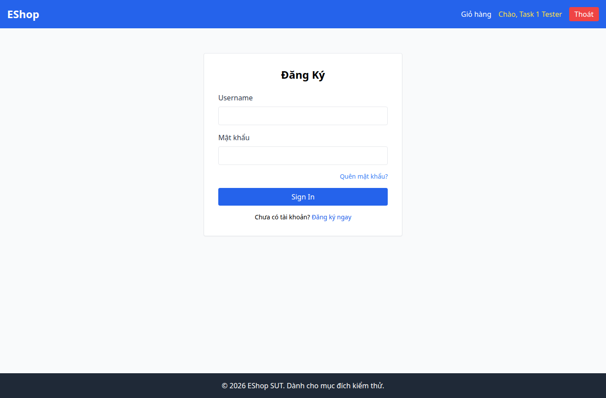
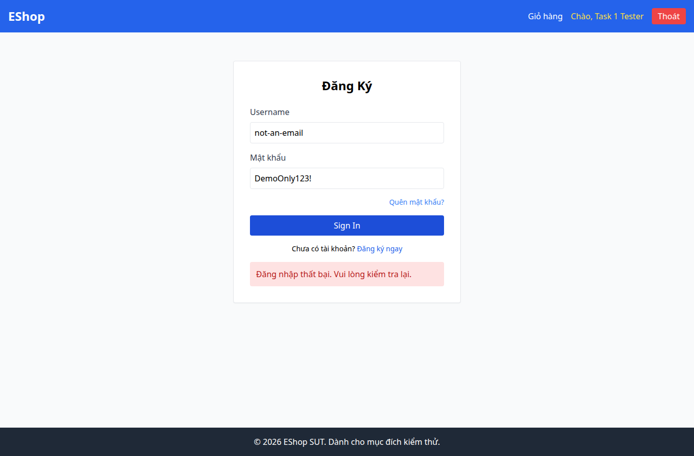

# BUG-004 — Email dùng text và không chặn định dạng sai

- Mức độ: **Moderate**
- Loại: Vi phạm đặc tả
- Checklist: GUI-005, GUI-010
- Môi trường: Linux x86_64; Chrome headless 156.0.8078.79; 1366×900, trừ ca responsive 360×800.
- SUT: eshop-sut commit 85af3ba; code không sửa trong lượt test.
- GitHub Issue: https://github.com/vinh-code/HW03-Software-Testing/issues/4

## Các bước tái hiện

Mở /login. Nhập not-an-email và DemoOnly123!, bấm Sign In. Kiểm tra HTML validity và phản hồi.

## Kết quả mong đợi và thực tế

### GUI-005
- Cơ sở: FR-02, FR-22
- Mong đợi: Email dùng type=email
- Thực tế: type email: text
- URL: http://localhost:5173/login
- Thời gian UTC: 2026-11-10T04:05:41.313Z

### GUI-010
- Cơ sở: FR-02
- Mong đợi: Email sai định dạng bị chặn tại form
- Thực tế: {"valid":true,"typeMismatch":false}; form gửi tới API và hiện lỗi đăng nhập
- URL: http://localhost:5173/login
- Thời gian UTC: 2026-11-10T04:05:41.618Z

## Giới hạn bằng chứng

Ảnh chụp trực tiếp bằng Playwright. Kiểm tra DOM, computed style và nội dung native alert nằm trong `../task1/evidence/results.json`. Native alert được Playwright ghi nhận rồi đóng; ảnh sau đó chụp nền trang, không phải ảnh của hộp thoại. Không dựng lại hộp thoại để làm bằng chứng.
