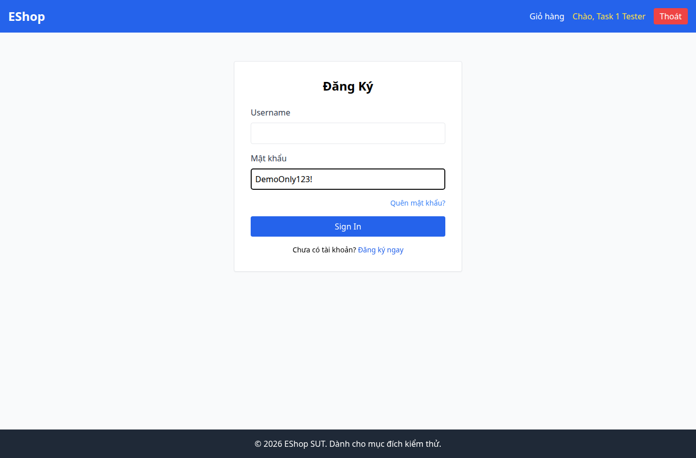

# BUG-005 — Mật khẩu đăng nhập hiển thị nguyên văn

- Mức độ: **Major**
- Loại: Vi phạm đặc tả
- Checklist: GUI-006
- Môi trường: Linux x86_64; Chrome headless 156.0.8078.79; 1366×900, trừ ca responsive 360×800.
- SUT: eshop-sut commit 85af3ba; code không sửa trong lượt test.
- GitHub Issue: https://github.com/vinh-code/HW03-Software-Testing/issues/5

## Các bước tái hiện

Mở /login. Nhập mật khẩu thử DemoOnly123!. Quan sát ký tự hiển thị và type của input.

## Kết quả mong đợi và thực tế

### GUI-006
- Cơ sở: FR-22
- Mong đợi: Mật khẩu dùng type=password
- Thực tế: type mật khẩu: text; nhập dữ liệu thử DemoOnly123!
- URL: http://localhost:5173/login
- Thời gian UTC: 2026-11-10T04:05:41.348Z

## Giới hạn bằng chứng

Ảnh chụp trực tiếp bằng Playwright. Kiểm tra DOM, computed style và nội dung native alert nằm trong `../task1/evidence/results.json`. Native alert được Playwright ghi nhận rồi đóng; ảnh sau đó chụp nền trang, không phải ảnh của hộp thoại. Không dựng lại hộp thoại để làm bằng chứng.
