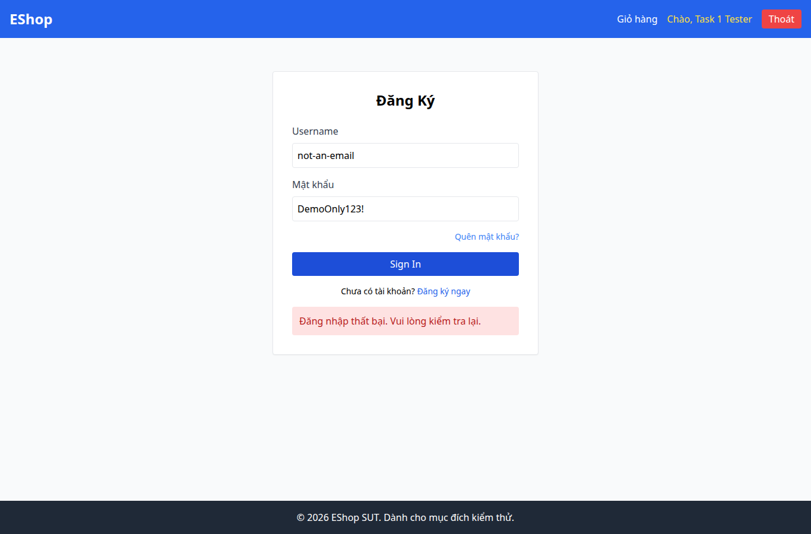

# BUG-007 — Lỗi đăng nhập nằm dưới nút gửi

- Mức độ: **Moderate**
- Loại: Vi phạm đặc tả
- Checklist: GUI-011
- Môi trường: Linux x86_64; Chrome headless 156.0.8078.79; 1366×900, trừ ca responsive 360×800.
- SUT: eshop-sut commit 85af3ba; code không sửa trong lượt test.
- GitHub Issue: Chưa đăng — chờ repository đích của sinh viên.

## Các bước tái hiện

Mở /login. Nhập not-an-email và DemoOnly123!, gửi form. Quan sát vị trí thông báo lỗi so với Sign In.

## Kết quả mong đợi và thực tế

### GUI-011
- Cơ sở: FR-22
- Mong đợi: Lỗi đăng nhập nằm phía trên nút gửi
- Thực tế: error.y=517, button.y=425
- URL: http://localhost:5173/login
- Thời gian UTC: 2026-11-10T04:05:41.648Z

## Giới hạn bằng chứng

Ảnh chụp trực tiếp bằng Playwright. Kiểm tra DOM, computed style và nội dung native alert nằm trong `../task1/evidence/results.json`. Native alert được Playwright ghi nhận rồi đóng; ảnh sau đó chụp nền trang, không phải ảnh của hộp thoại. Không dựng lại hộp thoại để làm bằng chứng.
