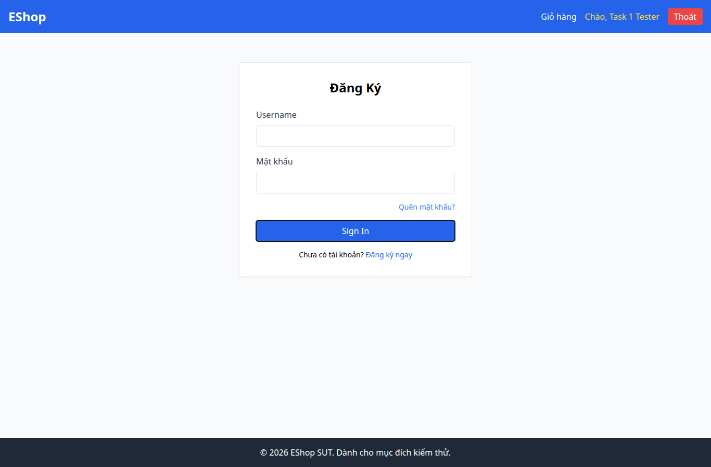

# BUG-008 — Tab từ đầu trang nhảy thẳng tới Sign In

- Mức độ: **Moderate**
- Loại: Vi phạm đặc tả
- Checklist: GUI-013
- Môi trường: Linux x86_64; Chrome headless 156.0.8078.79; 1366×900, trừ ca responsive 360×800.
- SUT: eshop-sut commit 85af3ba; code không sửa trong lượt test.
- GitHub Issue: https://github.com/vinh-code/HW03-Software-Testing/issues/8

## Các bước tái hiện

Mở mới /login và chờ form render. Nhấn Tab lần đầu. Quan sát phần tử focus; kiểm tra tabIndex.

## Kết quả mong đợi và thực tế

### GUI-013
- Cơ sở: FR-21
- Mong đợi: Tab đầu tiên đi vào phần tử tương tác trên cùng, không nhảy tới submit
- Thực tế: {"tag":"BUTTON","text":"Sign In","tabIndex":1}
- URL: http://localhost:5173/login
- Thời gian UTC: 2026-11-10T04:05:41.987Z

## Giới hạn bằng chứng

Ảnh chụp trực tiếp bằng Playwright. Kiểm tra DOM, computed style và nội dung native alert nằm trong `../task1/evidence/results.json`. Native alert được Playwright ghi nhận rồi đóng; ảnh sau đó chụp nền trang, không phải ảnh của hộp thoại. Không dựng lại hộp thoại để làm bằng chứng.
