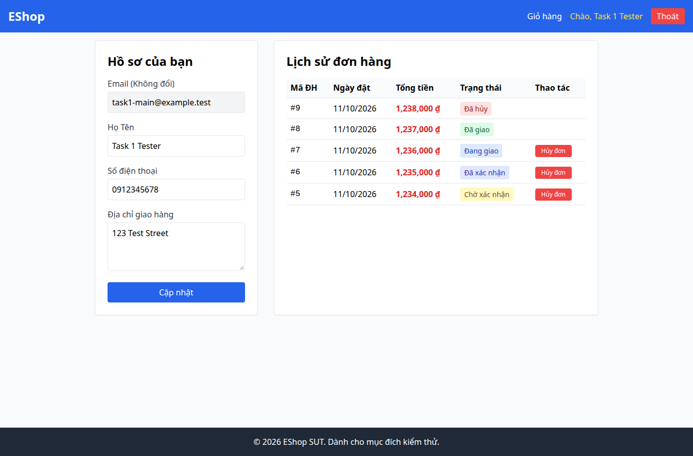

# BUG-009 — Validation điện thoại từ chối số hợp lệ và nhận số sai

- Mức độ: **Major**
- Loại: Vi phạm đặc tả
- Checklist: GUI-027, GUI-028
- Môi trường: Linux x86_64; Chrome headless 156.0.8078.79; 1366×900, trừ ca responsive 360×800.
- SUT: eshop-sut commit 85af3ba; code không sửa trong lượt test.
- GitHub Issue: Chưa đăng — chờ repository đích của sinh viên.

## Các bước tái hiện

Đăng nhập task1-main@example.test / GuiTest123!. Mở /profile. Nhập 0912345678, bấm Cập nhật; tiếp tục thử 123456789. Ghi nội dung alert mỗi lần.

## Kết quả mong đợi và thực tế

### GUI-027
- Cơ sở: FR-04
- Mong đợi: Số điện thoại hợp lệ 0912345678 được chấp nhận khi cập nhật
- Thực tế: [{"type":"alert","message":"Số điện thoại không hợp lệ. Vui lòng nhập đúng 9-10 chữ số."}]
- URL: http://localhost:5173/profile
- Thời gian UTC: 2026-11-10T04:06:34.759Z

### GUI-028
- Cơ sở: FR-04
- Mong đợi: Số điện thoại sai 123456789 bị từ chối
- Thực tế: [{"type":"alert","message":"Cập nhật thành công!"}]
- URL: http://localhost:5173/profile
- Thời gian UTC: 2026-11-10T04:06:35.106Z

## Giới hạn bằng chứng

Ảnh chụp trực tiếp bằng Playwright. Kiểm tra DOM, computed style và nội dung native alert nằm trong `../task1/evidence/results.json`. Native alert được Playwright ghi nhận rồi đóng; ảnh sau đó chụp nền trang, không phải ảnh của hộp thoại. Không dựng lại hộp thoại để làm bằng chứng.
