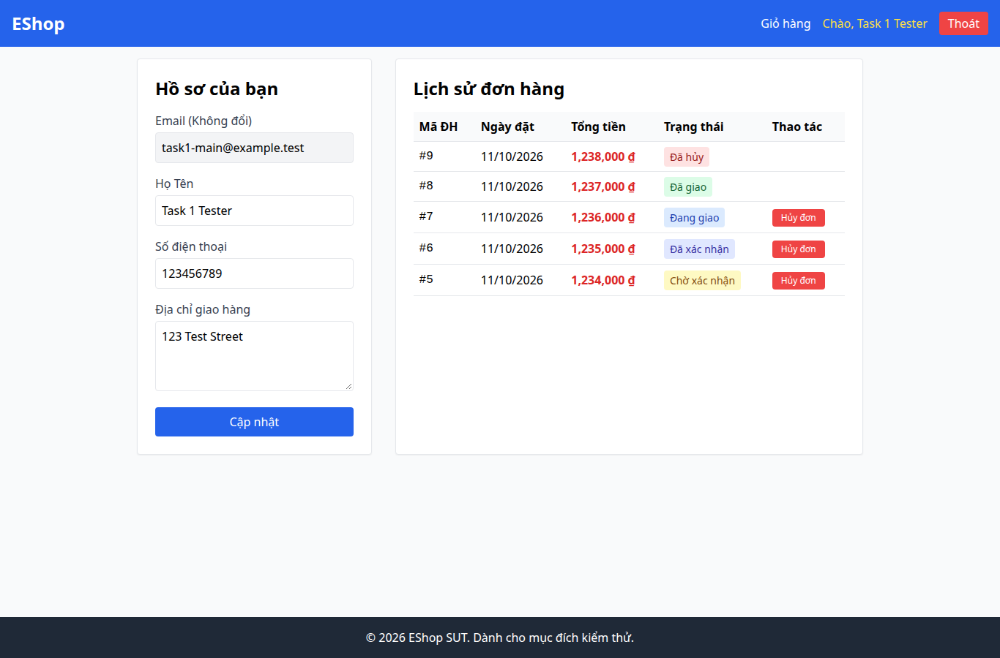

# BUG-010 — User thấy nút Hủy đơn khi đơn đang giao

- Mức độ: **Major**
- Loại: Vi phạm đặc tả
- Checklist: GUI-030
- Môi trường: Linux x86_64; Chrome headless 156.0.8078.79; 1366×900, trừ ca responsive 360×800.
- SUT: eshop-sut commit 85af3ba; code không sửa trong lượt test.
- GitHub Issue: https://github.com/vinh-code/HW03-Software-Testing/issues/10

## Các bước tái hiện

Seed fixture, đăng nhập tài khoản task1-main. Mở /profile, tìm đơn trạng thái Đang giao. Quan sát nút Hủy đơn.

## Kết quả mong đợi và thực tế

### GUI-030
- Cơ sở: FR-10
- Mong đợi: Đơn shipping không có nút Hủy đơn cho user
- Thực tế: shipping có 1 nút Hủy đơn
- URL: http://localhost:5173/profile
- Thời gian UTC: 2026-11-10T04:06:35.155Z

## Giới hạn bằng chứng

Ảnh chụp trực tiếp bằng Playwright. Kiểm tra DOM, computed style và nội dung native alert nằm trong `../task1/evidence/results.json`. Native alert được Playwright ghi nhận rồi đóng; ảnh sau đó chụp nền trang, không phải ảnh của hộp thoại. Không dựng lại hộp thoại để làm bằng chứng.
