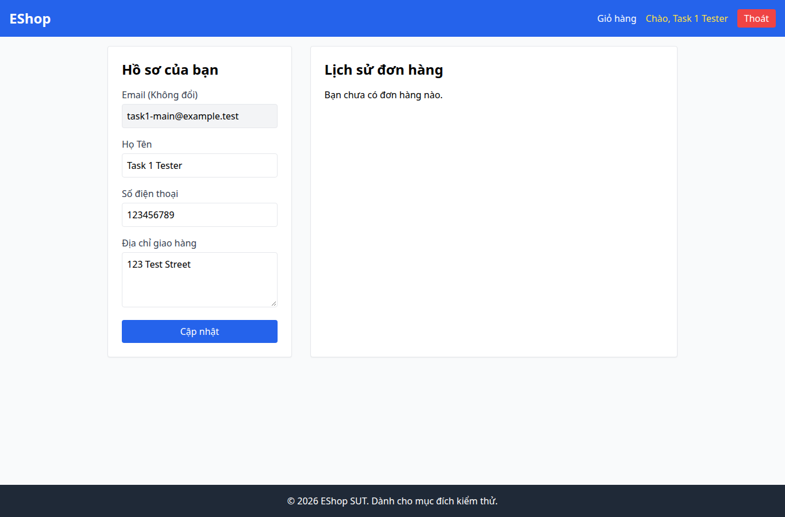

# BUG-011 — UX: đang tải đơn lại báo chưa có đơn

- Mức độ: **Moderate**
- Loại: UX bổ sung
- Checklist: GUI-036
- Môi trường: Linux x86_64; Chrome headless 156.0.8078.79; 1366×900, trừ ca responsive 360×800.
- SUT: eshop-sut commit 85af3ba; code không sửa trong lượt test.
- GitHub Issue: Chưa đăng — chờ repository đích của sinh viên.

## Các bước tái hiện

Đăng nhập tài khoản có đơn. Trì hoãn GET /api/orders/my-orders 1800ms bằng Playwright route; tải lại /profile và quan sát trong khi chờ. Đây là fault injection có ghi trong script.

## Kết quả mong đợi và thực tế

### GUI-036
- Cơ sở: IA-04; tiêu chí trạng thái bổ sung
- Mong đợi: Đang chờ tải đơn có chỉ báo tải, không báo chưa có đơn
- Thực tế: Nội dung trong lúc API trì hoãn 1800ms: Hồ sơ của bạn
Email (Không đổi)
Họ Tên
Số điện thoại
Địa chỉ giao hàng
Cập nhật
Lịch sử đơn hàng

Bạn chưa có đơn hàng nào.
- URL: http://localhost:5173/profile
- Thời gian UTC: 2026-11-10T04:06:35.491Z

## Giới hạn bằng chứng

Ảnh chụp trực tiếp bằng Playwright. Kiểm tra DOM, computed style và nội dung native alert nằm trong `../task1/evidence/results.json`. Native alert được Playwright ghi nhận rồi đóng; ảnh sau đó chụp nền trang, không phải ảnh của hộp thoại. Không dựng lại hộp thoại để làm bằng chứng.
