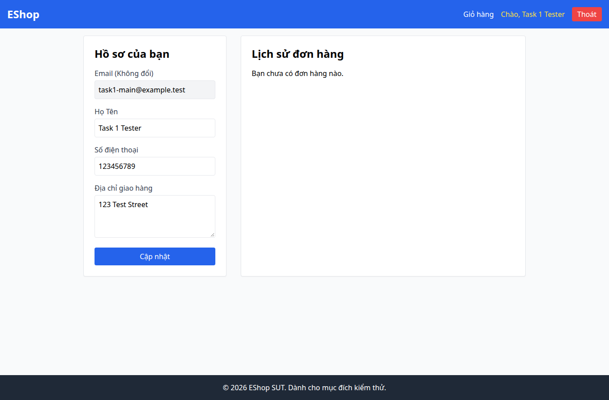

# BUG-012 — UX: API tải đơn lỗi 500 bị hiển thị thành danh sách trống

- Mức độ: **Moderate**
- Loại: UX bổ sung
- Checklist: GUI-037
- Môi trường: Linux x86_64; Chrome headless 156.0.8078.79; 1366×900, trừ ca responsive 360×800.
- SUT: eshop-sut commit 85af3ba; code không sửa trong lượt test.
- GitHub Issue: Chưa đăng — chờ repository đích của sinh viên.

## Các bước tái hiện

Đăng nhập tài khoản có đơn. Dùng Playwright route trả HTTP 500 cho GET /api/orders/my-orders; tải lại /profile. Không thay dữ liệu DOM; phản hồi mạng lỗi là dữ liệu thử có kiểm soát.

## Kết quả mong đợi và thực tế

### GUI-037
- Cơ sở: IA-04; tiêu chí phục hồi lỗi bổ sung
- Mong đợi: Lỗi tải đơn có thông báo lỗi, không báo chưa có đơn
- Thực tế: HTTP 500 được mô phỏng tại biên mạng; UI: Hồ sơ của bạn
Email (Không đổi)
Họ Tên
Số điện thoại
Địa chỉ giao hàng
Cập nhật
Lịch sử đơn hàng

Bạn chưa có đơn hàng nào.
- URL: http://localhost:5173/profile
- Thời gian UTC: 2026-11-10T04:06:37.663Z

## Giới hạn bằng chứng

Ảnh chụp trực tiếp bằng Playwright. Kiểm tra DOM, computed style và nội dung native alert nằm trong `../task1/evidence/results.json`. Native alert được Playwright ghi nhận rồi đóng; ảnh sau đó chụp nền trang, không phải ảnh của hộp thoại. Không dựng lại hộp thoại để làm bằng chứng.
