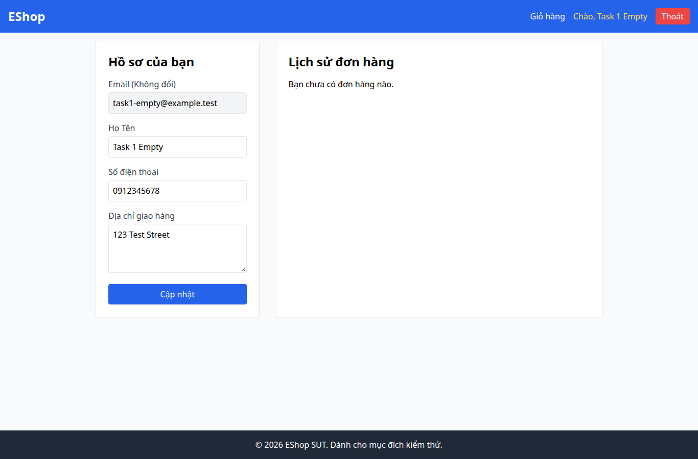

# BUG-013 — Empty state lịch sử đơn thiếu hình minh họa

- Mức độ: **Minor**
- Loại: Vi phạm đặc tả
- Checklist: GUI-038
- Môi trường: Linux x86_64; Chrome headless 156.0.8078.79; 1366×900, trừ ca responsive 360×800.
- SUT: eshop-sut commit 85af3ba; code không sửa trong lượt test.
- GitHub Issue: https://github.com/vinh-code/HW03-Software-Testing/issues/13

## Các bước tái hiện

Đăng nhập task1-empty@example.test / GuiTest123!, mở /profile. Quan sát khối lịch sử đơn trống.

## Kết quả mong đợi và thực tế

### GUI-038
- Cơ sở: FR-24
- Mong đợi: Không có đơn: có thông điệp thân thiện và icon/hình minh họa
- Thực tế: Thông điệp: Bạn chưa có đơn hàng nào.; số icon/ảnh: 0
- URL: http://localhost:5173/profile
- Thời gian UTC: 2026-11-10T04:06:38.384Z

## Giới hạn bằng chứng

Ảnh chụp trực tiếp bằng Playwright. Kiểm tra DOM, computed style và nội dung native alert nằm trong `../task1/evidence/results.json`. Native alert được Playwright ghi nhận rồi đóng; ảnh sau đó chụp nền trang, không phải ảnh của hộp thoại. Không dựng lại hộp thoại để làm bằng chứng.
