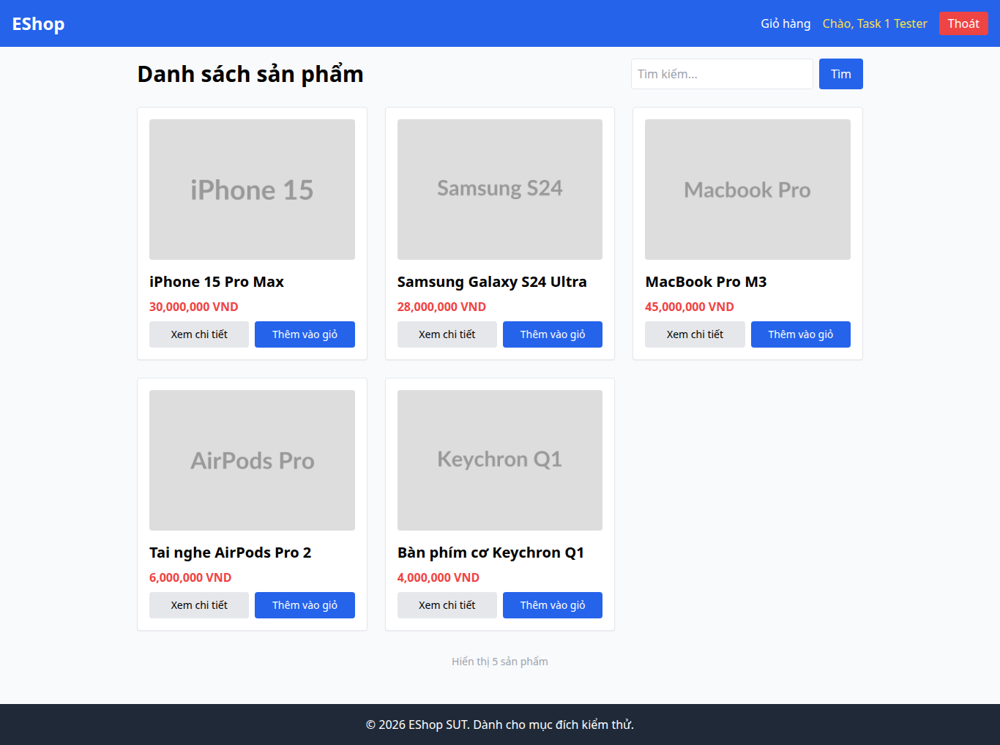

# BUG-015 — Navbar không đổi highlight theo trang hiện tại

- Mức độ: **Minor**
- Loại: Vi phạm đặc tả
- Checklist: GUI-040
- Môi trường: Linux x86_64; Chrome headless 156.0.8078.79; 1366×900, trừ ca responsive 360×800.
- SUT: eshop-sut commit 85af3ba; code không sửa trong lượt test.
- GitHub Issue: https://github.com/vinh-code/HW03-Software-Testing/issues/15

## Các bước tái hiện

Đăng nhập. Mở /profile rồi bấm EShop về Home. So sánh màu/class của link hồ sơ giữa hai trang.

## Kết quả mong đợi và thực tế

### GUI-040
- Cơ sở: FR-23
- Mong đợi: Navbar phân biệt trang đang chọn khi chuyển Home/Profile
- Thực tế: class tại Profile=hover:underline text-yellow-300; tại Home=hover:underline text-yellow-300
- URL: http://localhost:5173/
- Thời gian UTC: 2026-11-10T04:06:39.254Z

## Giới hạn bằng chứng

Ảnh chụp trực tiếp bằng Playwright. Kiểm tra DOM, computed style và nội dung native alert nằm trong `../task1/evidence/results.json`. Native alert được Playwright ghi nhận rồi đóng; ảnh sau đó chụp nền trang, không phải ảnh của hộp thoại. Không dựng lại hộp thoại để làm bằng chứng.
