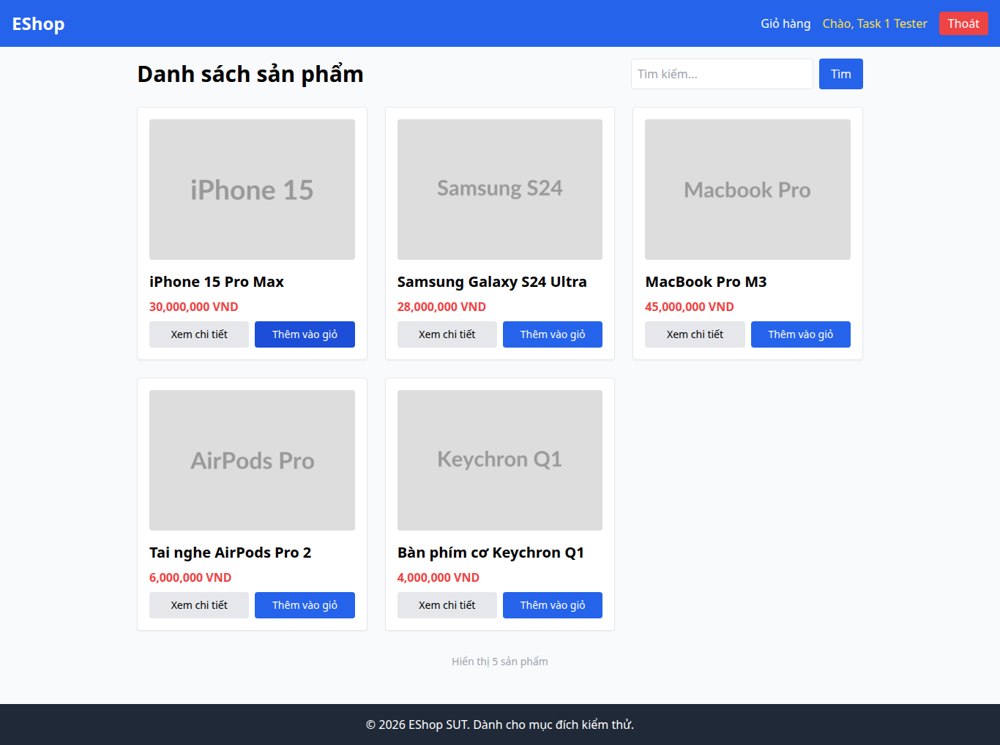

# BUG-016 — Giỏ hàng trên navbar không có badge số lượng

- Mức độ: **Moderate**
- Loại: Vi phạm đặc tả
- Checklist: GUI-043
- Môi trường: Linux x86_64; Chrome headless 156.0.8078.79; 1366×900, trừ ca responsive 360×800.
- SUT: eshop-sut commit 85af3ba; code không sửa trong lượt test.
- GitHub Issue: Chưa đăng — chờ repository đích của sinh viên.

## Các bước tái hiện

Đăng nhập, vào Home. Bấm Thêm vào giỏ ở sản phẩm đầu tiên. Quan sát link Giỏ hàng trên navbar.

## Kết quả mong đợi và thực tế

### GUI-043
- Cơ sở: FR-23
- Mong đợi: Giỏ hàng có badge số lượng sau khi thêm một sản phẩm
- Thực tế: Đã thêm 1 sản phẩm; link giỏ: Giỏ hàng
- URL: http://localhost:5173/
- Thời gian UTC: 2026-11-10T04:06:39.402Z

## Giới hạn bằng chứng

Ảnh chụp trực tiếp bằng Playwright. Kiểm tra DOM, computed style và nội dung native alert nằm trong `../task1/evidence/results.json`. Native alert được Playwright ghi nhận rồi đóng; ảnh sau đó chụp nền trang, không phải ảnh của hộp thoại. Không dựng lại hộp thoại để làm bằng chứng.
