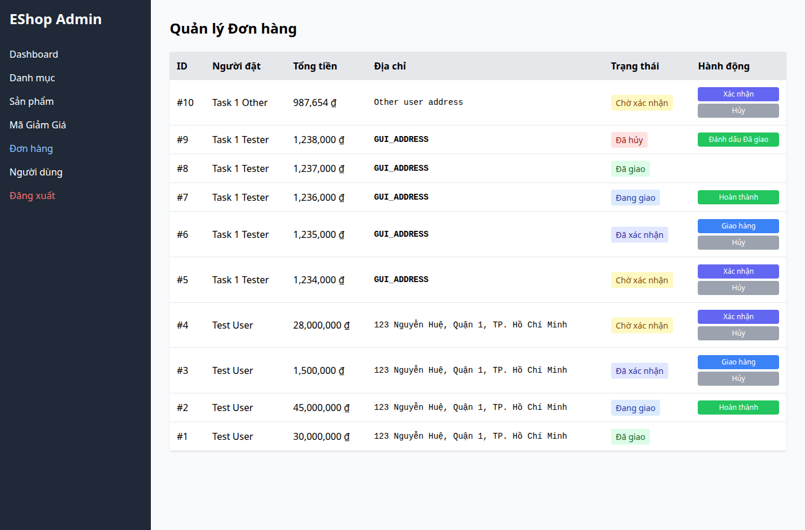

# BUG-017 — Admin vẫn có nút chuyển đơn Đã hủy sang Đã giao

- Mức độ: **Major**
- Loại: Vi phạm đặc tả
- Checklist: GUI-050
- Môi trường: Linux x86_64; Chrome headless 156.0.8078.79; 1366×900, trừ ca responsive 360×800.
- SUT: eshop-sut commit 85af3ba; code không sửa trong lượt test.
- GitHub Issue: Chưa đăng — chờ repository đích của sinh viên.

## Các bước tái hiện

Đăng nhập Admin bằng tài khoản demo. Chọn Đơn hàng, tìm đơn fixture Đã hủy. Quan sát nút Đánh dấu Đã giao. Ca này xác minh nút hiện sai, không tuyên bố đã bấm chuyển trạng thái.

## Kết quả mong đợi và thực tế

### GUI-050
- Cơ sở: FR-10, FR-18
- Mong đợi: Đơn canceled không có nút chuyển trạng thái
- Thực tế: canceled: ["Đánh dấu Đã giao"]
- URL: http://localhost:5174/
- Thời gian UTC: 2026-11-10T04:08:04.121Z

## Giới hạn bằng chứng

Ảnh chụp trực tiếp bằng Playwright. Kiểm tra DOM, computed style và nội dung native alert nằm trong `../task1/evidence/results.json`. Native alert được Playwright ghi nhận rồi đóng; ảnh sau đó chụp nền trang, không phải ảnh của hộp thoại. Không dựng lại hộp thoại để làm bằng chứng.
