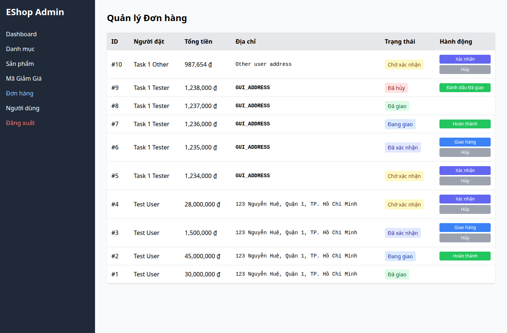

# BUG-018 — Nút Hủy đơn trong Admin có màu xám

- Mức độ: **Minor**
- Loại: Vi phạm đặc tả
- Checklist: GUI-052
- Môi trường: Linux x86_64; Chrome headless 156.0.8078.79; 1366×900, trừ ca responsive 360×800.
- SUT: eshop-sut commit 85af3ba; code không sửa trong lượt test.
- GitHub Issue: https://github.com/vinh-code/HW03-Software-Testing/issues/18

## Các bước tái hiện

Đăng nhập Admin, chọn Đơn hàng. Quan sát các nút Hủy của pending/confirmed, kiểm tra computed background-color.

## Kết quả mong đợi và thực tế

### GUI-052
- Cơ sở: FR-21
- Mong đợi: Các nút Hủy có màu đỏ
- Thực tế: ["rgb(156, 163, 175)","rgb(156, 163, 175)","rgb(156, 163, 175)","rgb(156, 163, 175)","rgb(156, 163, 175)"]
- URL: http://localhost:5174/
- Thời gian UTC: 2026-11-10T04:08:04.163Z

## Giới hạn bằng chứng

Ảnh chụp trực tiếp bằng Playwright. Kiểm tra DOM, computed style và nội dung native alert nằm trong `../task1/evidence/results.json`. Native alert được Playwright ghi nhận rồi đóng; ảnh sau đó chụp nền trang, không phải ảnh của hộp thoại. Không dựng lại hộp thoại để làm bằng chứng.
