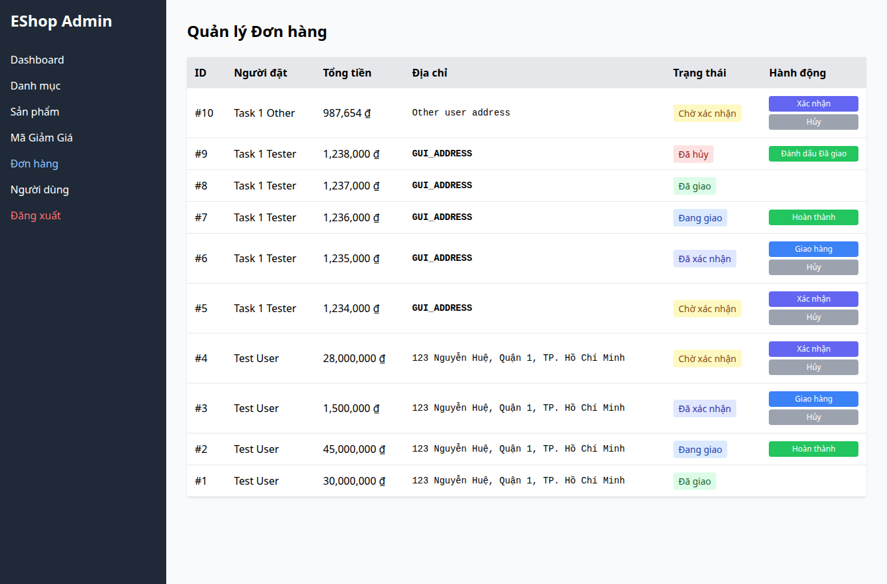

# BUG-019 — Địa chỉ giao hàng trong Admin bị render HTML

- Mức độ: **Major**
- Loại: Vi phạm đặc tả
- Checklist: GUI-053
- Môi trường: Linux x86_64; Chrome headless 156.0.8078.79; 1366×900, trừ ca responsive 360×800.
- SUT: eshop-sut commit 85af3ba; code không sửa trong lượt test.
- GitHub Issue: Chưa đăng — chờ repository đích của sinh viên.

## Các bước tái hiện

Seed địa chỉ đơn fixture thành chuỗi vô hại <b>GUI_ADDRESS</b>. Mở Admin > Đơn hàng. Quan sát chữ đậm và kiểm tra có node b trong ô địa chỉ. Không dùng payload thực thi script.

## Kết quả mong đợi và thực tế

### GUI-053
- Cơ sở: FR-18, SEC-04
- Mong đợi: Địa chỉ chứa <b> được hiển thị dưới dạng văn bản an toàn
- Thực tế: Thẻ b render: 1; text: GUI_ADDRESS
- URL: http://localhost:5174/
- Thời gian UTC: 2026-11-10T04:08:04.198Z

## Giới hạn bằng chứng

Ảnh chụp trực tiếp bằng Playwright. Kiểm tra DOM, computed style và nội dung native alert nằm trong `../task1/evidence/results.json`. Native alert được Playwright ghi nhận rồi đóng; ảnh sau đó chụp nền trang, không phải ảnh của hộp thoại. Không dựng lại hộp thoại để làm bằng chứng.
