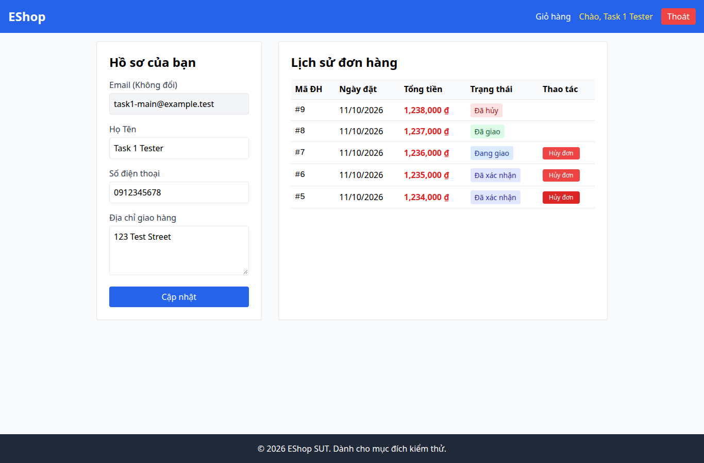

# BUG-020 — Lỗi hủy đơn hiển thị chuỗi tiếng Anh từ API

- Mức độ: **Moderate**
- Loại: Vi phạm đặc tả
- Checklist: GUI-055
- Môi trường: Linux x86_64; Chrome headless 156.0.8078.79; 1366×900, trừ ca responsive 360×800.
- SUT: eshop-sut commit 85af3ba; code không sửa trong lượt test.
- GitHub Issue: Chưa đăng — chờ repository đích của sinh viên.

## Các bước tái hiện

User mở /profile khi đơn còn confirmed. Admin chuyển cùng đơn qua shipping rồi delivered bằng API. Không tải lại trang user; bấm Hủy đơn trên dữ liệu cũ. Ghi alert Lỗi: Cannot cancel this order.

## Kết quả mong đợi và thực tế

### GUI-055
- Cơ sở: FR-21; IA-04
- Mong đợi: Thông báo lỗi hủy đơn từ API dùng tiếng Việt dễ hiểu
- Thực tế: [{"type":"alert","message":"Lỗi: Cannot cancel this order."}]; user đang xem trang cũ, admin đã chuyển đơn sang delivered
- URL: http://localhost:5173/profile
- Thời gian UTC: 2026-11-10T04:08:05.429Z

## Giới hạn bằng chứng

Ảnh chụp trực tiếp bằng Playwright. Kiểm tra DOM, computed style và nội dung native alert nằm trong `../task1/evidence/results.json`. Native alert được Playwright ghi nhận rồi đóng; ảnh sau đó chụp nền trang, không phải ảnh của hộp thoại. Không dựng lại hộp thoại để làm bằng chứng.
