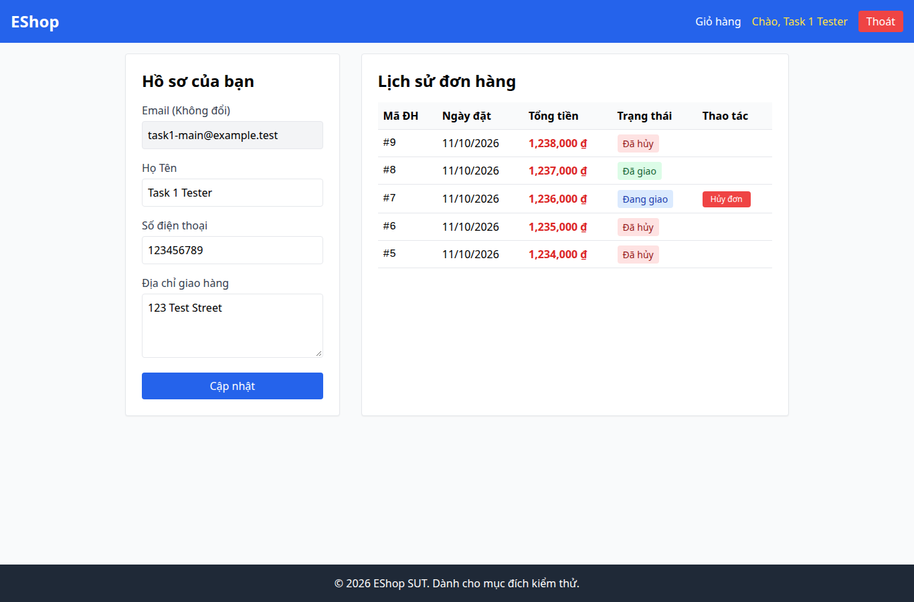

# BUG-021 — UX: nhãn form hồ sơ không liên kết với ô nhập

- Mức độ: **Moderate**
- Loại: UX bổ sung
- Checklist: GUI-056
- Môi trường: Linux x86_64; Chrome headless 156.0.8078.79; 1366×900, trừ ca responsive 360×800.
- SUT: eshop-sut commit 85af3ba; code không sửa trong lượt test.
- GitHub Issue: https://github.com/vinh-code/HW03-Software-Testing/issues/21

## Các bước tái hiện

Đăng nhập, mở /profile. Inspect label/control của Họ Tên, Số điện thoại, Địa chỉ. Các control có labels.length=0; thử click nhãn để kiểm tra focus.

## Kết quả mong đợi và thực tế

### GUI-056
- Cơ sở: IA-02; khả năng truy cập bổ sung
- Mong đợi: Nhãn Họ tên/Điện thoại/Địa chỉ liên kết với control tương ứng
- Thực tế: [{"type":"INPUT","labels":0},{"type":"INPUT","labels":0},{"type":"TEXTAREA","labels":0}]
- URL: http://localhost:5173/profile
- Thời gian UTC: 2026-11-10T04:06:40.201Z

## Giới hạn bằng chứng

Ảnh chụp trực tiếp bằng Playwright. Kiểm tra DOM, computed style và nội dung native alert nằm trong `../task1/evidence/results.json`. Native alert được Playwright ghi nhận rồi đóng; ảnh sau đó chụp nền trang, không phải ảnh của hộp thoại. Không dựng lại hộp thoại để làm bằng chứng.
