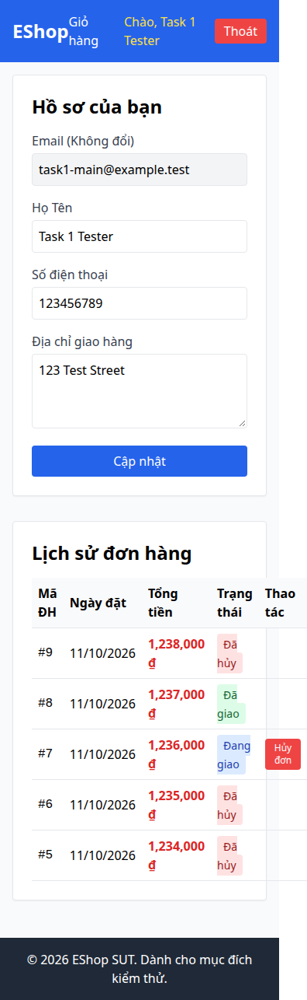

# BUG-022 — UX: lịch sử đơn làm tràn ngang ở viewport 360px

- Mức độ: **Moderate**
- Loại: UX bổ sung
- Checklist: GUI-057
- Môi trường: Linux x86_64; Chrome headless 156.0.8078.79; 1366×900, trừ ca responsive 360×800.
- SUT: eshop-sut commit 85af3ba; code không sửa trong lượt test.
- GitHub Issue: https://github.com/vinh-code/HW03-Software-Testing/issues/22

## Các bước tái hiện

Đăng nhập, mở /profile có đơn. Đặt viewport 360x800. So sánh documentElement.scrollWidth với innerWidth và quan sát bảng bị tràn. Đây là viewport desktop, không phải mobile thật.

## Kết quả mong đợi và thực tế

### GUI-057
- Cơ sở: IA-01; responsive bổ sung
- Mong đợi: Ở 360px nội dung không gây cuộn ngang toàn trang
- Thực tế: {"viewport":360,"scroll":396}
- URL: http://localhost:5173/profile
- Thời gian UTC: 2026-11-10T04:06:40.526Z

## Giới hạn bằng chứng

Ảnh chụp trực tiếp bằng Playwright. Kiểm tra DOM, computed style và nội dung native alert nằm trong `../task1/evidence/results.json`. Native alert được Playwright ghi nhận rồi đóng; ảnh sau đó chụp nền trang, không phải ảnh của hộp thoại. Không dựng lại hộp thoại để làm bằng chứng.
