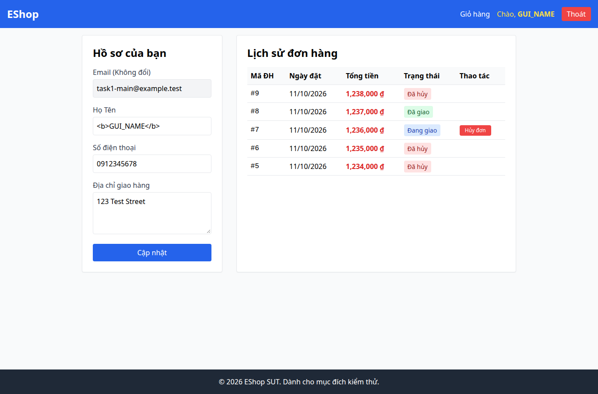

# BUG-023 — Tên người dùng trên navbar bị render HTML

- Mức độ: **Major**
- Loại: Vi phạm đặc tả
- Checklist: GUI-058
- Môi trường: Linux x86_64; Chrome headless 156.0.8078.79; 1366×900, trừ ca responsive 360×800.
- SUT: eshop-sut commit 85af3ba; code không sửa trong lượt test.
- GitHub Issue: https://github.com/vinh-code/HW03-Software-Testing/issues/23

## Các bước tái hiện

Dùng tài khoản fixture, cập nhật name thành <b>GUI_NAME</b> qua API. Tải lại /profile. Quan sát header hiển thị chữ đậm và có node b. Khôi phục tên sau ca thử.

## Kết quả mong đợi và thực tế

### GUI-058
- Cơ sở: SEC-04
- Mong đợi: Tên người dùng chứa <b> hiển thị nguyên văn, không render HTML
- Thực tế: Số thẻ b được render: 1; text: Chào, GUI_NAME
- URL: http://localhost:5173/profile
- Thời gian UTC: 2026-11-10T04:06:41.009Z

## Giới hạn bằng chứng

Ảnh chụp trực tiếp bằng Playwright. Kiểm tra DOM, computed style và nội dung native alert nằm trong `../task1/evidence/results.json`. Native alert được Playwright ghi nhận rồi đóng; ảnh sau đó chụp nền trang, không phải ảnh của hộp thoại. Không dựng lại hộp thoại để làm bằng chứng.
